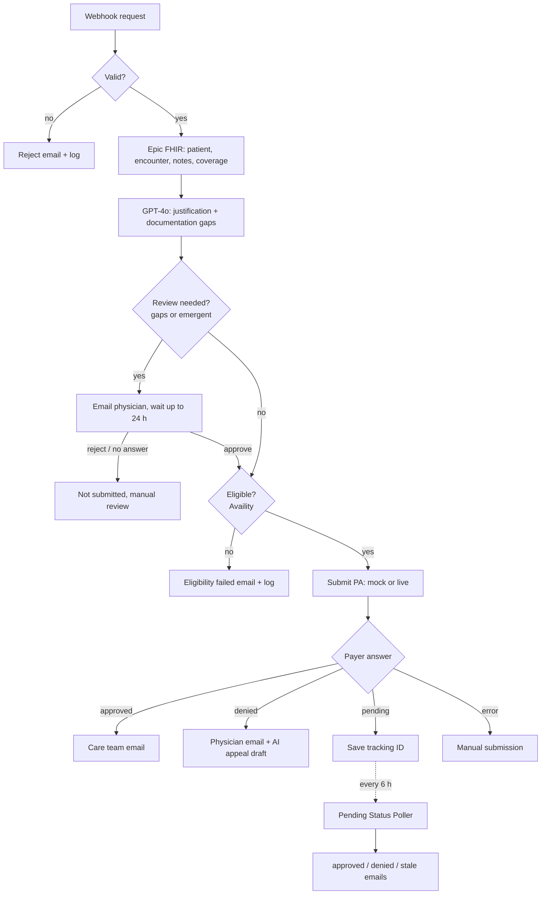

# Prior Authorization Automation (n8n + Epic FHIR + Availity + Supabase)

**A prior-authorization request goes in; a payer decision, the right email and a full audit trail come out. Nothing reaches the payer without passing validation, an eligibility check and, when needed, a physician's sign-off.** Built with n8n, Epic FHIR, OpenAI, the Availity API and Supabase.

`2 workflows · 61 nodes · 12 recorded statuses · runs in mock mode by default`

## The pain point
Prior authorizations delay patient care by days. Staff copy the same clinical data from the EHR into payer portals, chase eligibility, re-check pending requests by hand, and write appeal letters from scratch after a denial. Automating it is risky, though:
- the medical-necessity justification must use **only what the physician documented**
- some requests must **never** go to the payer without a physician's decision
- patient identity data must stay **protected** at rest
- every request must end in a **known, recorded state**, never silently stuck

## What it does
**Main workflow** (`workflows/prior_auth_main_workflow.json`, 47 nodes)
1. **Intake:** a webhook receives the request; required fields are validated and normalised. Invalid requests are rejected with an email and logged.
2. **Chart data:** signs a JWT and pulls Patient, Encounter, clinical notes and Coverage from **Epic FHIR R4** (public sandbox by default).
3. **AI justification:** GPT-4o (temperature 0, JSON mode) extracts the diagnosis, evidence, treatments already tried, urgency and a medical-necessity statement, and also lists **documentation gaps**. If parsing fails, safe fallbacks are used and the case is flagged for review.
4. **Physician review:** if the AI flags insufficient documentation or the case is emergent, the physician gets an email and the workflow **waits up to 24 h** for their decision. Reject or no answer means the request is not submitted and is queued for manual review.
5. **Eligibility:** checks coverage with Availity (with polling) before anything is submitted.
6. **Submission:** builds the service-review request and submits it to Availity, or simulates the payer in **mock mode**.
7. **Outcome:** approved → care team; denied → physician, with an **AI-drafted appeal letter**; pending → tracking ID saved for the poller; error → flagged for manual submission.
8. **Audit:** every step writes to Supabase through one function, `log_prior_auth()`.

**Pending Status Poller** (`workflows/prior_auth_pending_status_poller.json`, 14 nodes)
Every 6 hours it reads requests that are `pending` and due for a check, asks Availity for the decision (or simulates it), updates Supabase and emails care team (approved), physician (denied) or billing (still undecided after 28 checks, about 7 days → `stale`).

## Guardrails and design decisions
| Risk | What I did |
|---|---|
| AI inventing clinical facts | The extraction prompt allows **only facts written in the note**, returns empty evidence when none is written, and lists documentation gaps instead of filling them |
| Submitting a weak or urgent case unchecked | Insufficient documentation or emergent urgency routes to a **physician**; only their approval continues, and rejection or silence stops the request |
| Wasted or rejected submissions | Eligibility is checked first; inactive coverage stops before submission |
| Testing against a real payer by accident | **Mock mode is the default** (`AVAILITY_PA_MODE = mock`). The poller decides mock vs live **per request** from the saved `is_mock` flag, so test requests never reach Availity |
| PHI at rest | Patient name and DOB are stored **encrypted with pgcrypto**; the key lives in **Supabase Vault**, never in n8n. Decryption is a separate service-role-only function |
| Who can read the audit log | Row-level security is on with no policies, and anon/authenticated roles are revoked. Only the service role can write, through `log_prior_auth()`. A **PHI-free view** (`prior_auth_dashboard`) exists for reporting |
| Requests stuck in limbo | Every path writes one of 12 statuses (`approved`, `denied`, `pending`, `stale`, `eligibility_failed`, `physician_rejected`, …) plus an append-only event history |
| Pending forever | The poller stops after 28 checks and hands the case to billing as `stale` |
| AI writing the final word | The appeal letter is a **draft** for the physician, who reviews and sends it |
| Emails leaking identity | The poller's emails carry only the request ID and procedure code. Main-workflow emails to staff still include some identifiers (see limitations) |

## Repository layout
| Path | What it is |
|---|---|
| `workflows/prior_auth_main_workflow.json` | Main workflow (intake → FHIR → AI → physician review → eligibility → submission → outcome → audit) |
| `workflows/prior_auth_pending_status_poller.json` | 6-hourly re-check of pending requests |
| `supabase/phase6_supabase_setup.sql` | Tables, RLS, `log_prior_auth()`, decrypt helper and PHI-free reporting view |
| `sample/sample_request.json` | A fictional test request (Epic public sandbox patient) |
| `scripts/` | `sanitize.py` and `check_secrets.py`, run before every commit |

## Run it yourself
1. **Supabase**
   - Generate a key with `openssl rand -hex 32` and keep a copy in your password manager.
   - In the SQL Editor run: `select vault.create_secret('<your key>', 'prior_auth_encryption_key', 'pgcrypto key for prior auth PHI columns');`
   - Run `supabase/phase6_supabase_setup.sql`.
2. **n8n**
   - Import both files from `workflows/`.
   - Create and attach these credentials:
     - Supabase API (service-role key)
     - Gmail OAuth2
     - Availity OAuth2
     - JWT (your Epic private key)
     - OpenAI API
   - In each `Config` node set the following (the exports use placeholders):
     - `SUPABASE_URL`
     - `EPIC_CLIENT_ID`
     - `ORG_NPI`
     - the email recipients
3. **Test in mock mode**
   - Post `sample/sample_request.json` to the webhook.
   - Use `MOCK_PA_OUTCOME` (main) and `MOCK_POLL_OUTCOME` (poller) to exercise approved, denied, pending and error.
4. **Activate** the poller so it runs on its 6-hour schedule.

Never use real patient data for testing.

## Known limitations
- **This is a prototype.** A HIPAA review and BAAs with every service that receives PHI (OpenAI, Gmail, the n8n host, Supabase) are out of scope.
- **PHI outside the database:**
  - The appeal-letter prompt includes the patient's name, DOB and member ID (the extraction prompt doesn't).
  - The main workflow's approved email includes the patient's name, and its eligibility-failure email includes the member ID.
  - Next step: send only codes and clinical text to the LLM, and keep identity details out of emails.
- **Auth and links:**
  - The intake webhook has no authentication yet.
  - Physician approval uses n8n's built-in wait/resume URL, which is unique per run and expires after 24 h, but isn't signed.
- **Availity:** the Service Reviews endpoints and response fields must be confirmed against Availity's documentation before switching to live mode.
- **Epic:** uses the public FHIR sandbox. Production needs an approved Epic app and the customer's FHIR base URL.

---
Built by **Vennela Davunuri**, AI Automation Engineer · [All my workflows](https://github.com/venneladavunuri98-cloud/n8n-ai-workflows) · [Portfolio](https://portfolio-vennela3.vercel.app) · [LinkedIn](https://www.linkedin.com/in/venneladavunuri/)
