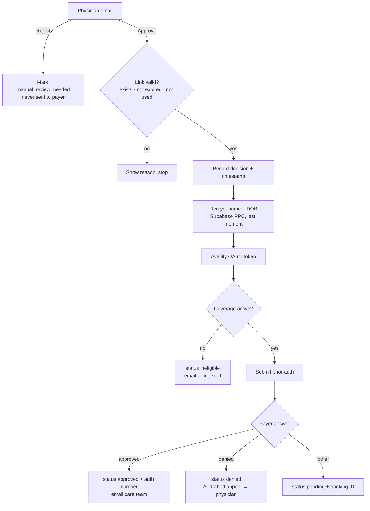

# Prior Authorization: Physician Approval → Payer Submission

**One click from the physician turns a prepared prior-authorization request into a payer submission, and nothing reaches the payer without that click.** Built with n8n, Supabase, the Availity API and OpenAI.

`30 nodes · 2 webhook entry points · 5 final states`

## The pain point
Prior authorizations delay patient care by days. Staff re-key the same clinical data into payer portals, chase eligibility, and write appeal letters from scratch after a denial. Automating it is risky, though:
- a request must never go to the payer without a **physician's decision**
- patient identity data must stay **protected** until it's actually needed
- every request must end in a **known, recorded state**, never silently stuck

## What I built
Workflow B of a two-part system. Workflow A (not included) extracts the clinical data, stores the request and emails the physician **Approve** and **Reject** links. This workflow handles those clicks.

## Guardrails and design decisions
| Risk | What I did |
|---|---|
| Submitting without a doctor's decision | Human in the loop: only an Approve click starts submission; Reject routes to staff and **never** reaches the payer |
| Replayed or forwarded links | Approval links are single-use and expire after 24 h; already-decided or expired links stop with a clear reason |
| PHI exposure | Patient name and DOB are stored encrypted and decrypted through a database function **only at submission time** |
| PHI sent to the LLM | The appeal-letter prompt gets codes, payer, NPI and clinical text, but **not** the patient's name, DOB or member ID |
| Wasted or rejected submissions | An eligibility check runs first; inactive coverage stops before submission |
| AI writing the final word | The appeal letter is a **draft** emailed to the physician, who edits and submits it; if generation fails, the email says to draft manually |
| Secrets in the workflow | Keys live in n8n Variables (`$vars.SUPABASE_SERVICE_KEY`, `$vars.AVAILITY_CLIENT_SECRET`), never in the JSON |
| Requests stuck in limbo | Every path writes a status: `manual_review_needed`, `ineligible`, `approved`, `denied` or `pending` |

## Data model (Supabase)
See [`docs/DATA_MODEL.md`](docs/DATA_MODEL.md) and a fake request in [`sample/sample_request.json`](sample/sample_request.json).

## Run it yourself
1. Create the two tables and the `decrypt_patient_phi` function in Supabase (see `docs/DATA_MODEL.md`).
2. Import `workflows/workflow-b-physician-approval.json` into n8n.
3. Add the variables from `.env.example` under **Settings → Variables**, and connect the Supabase, OpenAI and Gmail credentials.
4. Use the **Availity sandbox** with the fake sample request. Never use real patient data for testing.
5. Open `https://YOUR-N8N-HOST/webhook/approve/<request_id>` to test the approve path.

## Known limitations
- This is a **prototype**. A HIPAA, BAA and vendor compliance review is out of scope.
- Workflow A (clinical extraction and the approval email) isn't included.
- Approval links aren't cryptographically signed yet (planned: HMAC-signed links).
- There's no polling of pending payer decisions yet.

---
Built by **Vennela Davunuri**, AI Automation Engineer · [All my workflows](https://github.com/venneladavunuri98-cloud/n8n-ai-workflows) · [Portfolio](https://portfolio-vennela3.vercel.app) · [LinkedIn](https://www.linkedin.com/in/venneladavunuri/)
